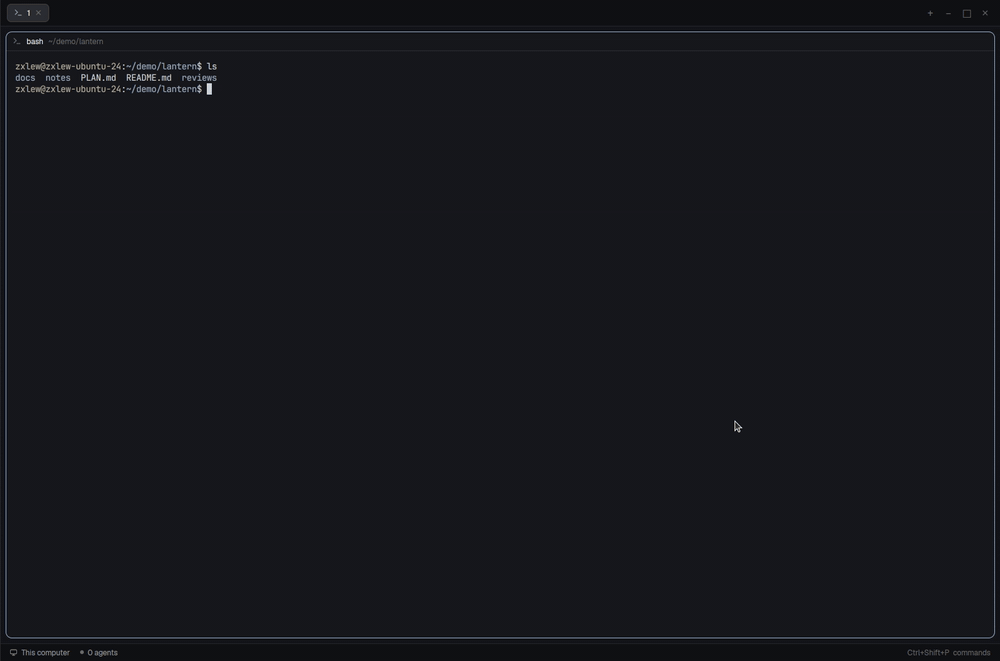

# md-viewer

A Markdown viewer and editor for the [Herdr](https://herdr.dev) app. Read the
plans, notes and reviews your agents write in a window over any layout or in
a tab of their own. You can edit them right where you read them.



## Features

- **Opens from anywhere**: Ctrl+Shift+M (Cmd+Shift+M on macOS) opens a window
  with the Markdown files of the focused pane's folder.
- **A list you can search**: files are grouped by folder, and a filter box
  narrows them as you type.
- **Formatted reading**: headings, lists, tables, code and links are rendered.
  YAML front matter shows as a code block.
- **Edit block by block**: double-click a paragraph, list or heading to edit
  just that block while the rest stays formatted. A table opens as a grid of
  cells. "Source" edits the whole file as plain Markdown.
- **Saves as you type**: changes are saved within a second, and never over a
  change an agent made to the file meanwhile; you choose which version stays.
- **Live**: while you aren't editing, the document follows the file, so an
  agent writing a plan shows up as it writes.
- **A real window**: resize it from any edge or corner, move it, maximize it
  to fill Herdr and restore it to where it was.
- **Open in new tab**: open any file in its own Herdr tab, where you can split
  a terminal beside it.
- **Open in window**: open any file in a window of its own. It floats over
  every space (a tab stays in its space), and you can move, resize, maximize
  and close it on its own. Open as many as you like.
- **Download a copy**: save the file you're reading, edits included, anywhere.
  On Windows it's the usual Save As dialog (rename it, see what's there; it asks
  before replacing a file). On macOS and Linux you pick a folder, and a name
  already taken there becomes "name (1).md".
  The "Downloaded" message stays 30 seconds (a strip counts down, and it waits
  while the pointer is on it); its buttons open the copy in a tab or show it
  in its folder. Clicking it doesn't close it; only its close button or the
  countdown does.
- **Other machines**: in a pane on an SSH machine, it lists and shows that
  machine's files (read only).
- **Reviews**: `md-review <file>` lets an agent hand you a file to review and
  get your changes back as a diff.

## Install

The easiest way is to ask the coding agent in your Herdr terminal:

> Read ~/.config/herdr-app/AGENTS.md, then add this mod: https://github.com/zxlew693/md-viewer

Or by hand:

1. Copy `mods/md-viewer/` into Herdr's mods folder, `~/.config/herdr-app/mods/`.
2. Add the key from `keys.json` to your own `~/.config/herdr-app/keys.json`,
   under `"global"`:
   ```json
   "ctrl-shift-m": "mod.open:md-viewer"
   ```
   On macOS, use `"cmd-shift-m"` instead.
3. Check it loads:
   ```sh
   herdr-app check ~/.config/herdr-app/mods/md-viewer
   ```

Herdr picks it up at once; no restart is needed. To remove it, delete the
folder and the key.

### Update

From a clone of this repo (the first time,
`git clone https://github.com/zxlew693/md-viewer.git ~/src/md-viewer`):

```sh
cd ~/src/md-viewer && git pull
rsync -a --delete mods/md-viewer/ ~/.config/herdr-app/mods/md-viewer/
herdr-app check ~/.config/herdr-app/mods/md-viewer
```

`--delete` removes files the repo no longer has; leave it off if you keep your
own files in that folder. If `herdr-app` isn't on your PATH on macOS, use
`/Applications/Herdr.app/Contents/MacOS/Herdr check ...`. Herdr reloads the mod
at once, but the reload can close open md-viewer windows; press the key again.

## Use

| Action | How |
|---|---|
| Open or close the window | Ctrl+Shift+M |
| Show a file | Click it in the list |
| Open a file in its own window | The window icon on its row, or in the header |
| Open a file in a new tab | The arrow icon at the end of its row, or in the header |
| Download a copy | The tray icon in the header or on a row in the list |
| Filter the list | Type in the box at the top; Escape clears it |
| Edit a block | Double-click it; Escape when done |
| Save now | Ctrl+S (it also saves by itself) |
| Resize | Drag any edge or corner |
| Maximize or restore | The square button in the header |
| Back to the list | The chevron at the top left |
| Close | The ×, or Escape |

### Reviews with `md-review` (optional)

Link `mods/md-viewer/md-review` into your `PATH`. Inside a Herdr terminal,
`md-review plan.md` opens the file and waits; click **Done** in the header and
it prints what you changed as a diff. `md-review --rule` prints a short
instruction you can add to an agent's setup, so it asks for reviews this way.

### Opening `.md` files from macOS (optional)

`sh mods/md-viewer/markdown-handler.sh install` makes `.md` files (and Cmd-click
on a path in a terminal) open in md-viewer instead of another app;
`... uninstall` undoes it. It needs Xcode or its Command Line Tools.

## What it runs

md-viewer runs `git`, `hc` and, on Windows, PowerShell to list files and see
what the focused terminal mentioned. It reads the Markdown files you open, your
clipboard, and a Claude Code session's scratchpad. It writes only the file you
edit, plus small inbox folders under `~/.config/herdr-app/data/`. It makes no
network requests; a link opens in your browser only when you click it.

## Building it yourself

[`RECIPE.md`](RECIPE.md) is the full brief: what you see, how it behaves, what
it's built from and what to watch out for. An agent can rebuild the mod from it
alone.

## License and credits

Apache License 2.0; see [`LICENSE`](LICENSE) and [`NOTICE`](NOTICE).
Copyright 2026 zxlew693.

Based on the markdown-panel mod of [Kanso](https://github.com/jlopezlira/herdr-kanso)
by jlopezlira. The reviews, the Escape key and "From this terminal" come from
[herdr-md-review](https://github.com/h0ru5/herdr-md-review) by Johannes Hund.
The chevron icon is from [Lucide](https://lucide.dev) (ISC License).
