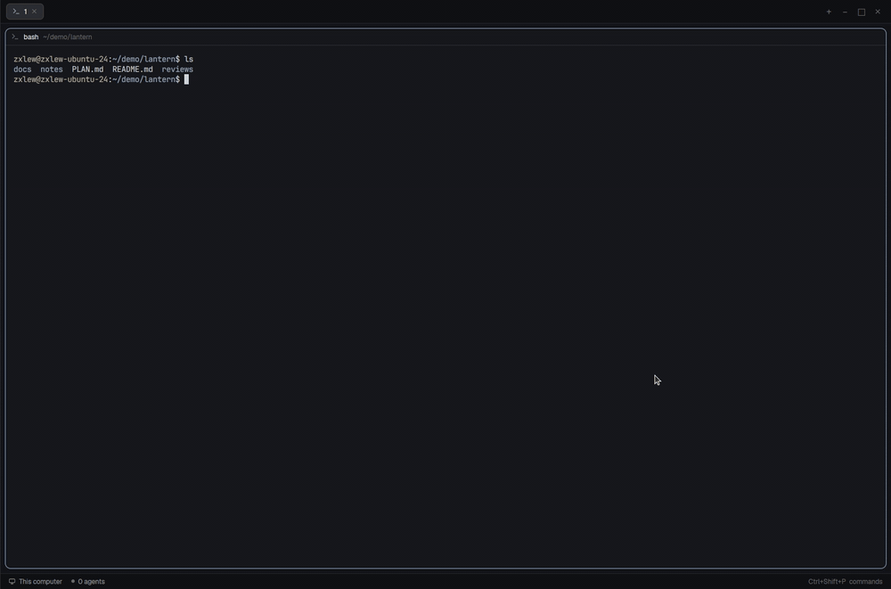

# md-viewer

The plans, notes and reviews your agents write, in a window over any layout:
formatted, and edited where they read. Ctrl+Shift+M opens a window centered
over Herdr with the Markdown files of the focused pane's folder, grouped by
folder and filtered as you type. A click shows a file formatted; double-click a
paragraph, a list or a heading to edit just that block, and a table opens as a
grid of cells. What you type is saved as you go, and never over a change an
agent made meanwhile. The window resizes from any edge or corner like any
window, maximizes and restores, and any file opens in its own Herdr tab.

This file is the brief: enough to build the mod from an empty folder. The
files next to it are one build of it.

## What you see

- **The window** (`kind: "window"`, `frame: "none"`): the panel draws its own
  frame, on the theme's `background`, a 1 px `border`, radius 8, `shadow_lg`,
  text 13 px. It opens centered, 560 wide and 90% of Herdr's height the first
  time, then at the size you last dragged it to. Around it, a 6 px invisible
  resize border. It doesn't dim Herdr and stays open until closed.
- **Header**, 42 tall, 10 side padding, a 1 px `border` line under it:
  - with a file: a back chevron, the file's name (semibold) over its folder
    (11, `dim`; `~\...` under your home), the saving state (11.5, `dim`:
    "Edited", "Saving…", "Saved"; "Read only" for a file on another machine),
    "Source" (or "Formatted"), Read again, Open in new tab, Maximize (or
    Restore), Close;
  - with none: "Markdown" over the folder, Look for Markdown again, Maximize,
    Close.
  Icons are 14 px strokes, `muted`, `hover` background on hover.
- **The list** (no file open):
  - a toolbar, 8/10 padding, a `border` line under it: a filter box, 30 tall,
    radius 7, `raised` background, an `input` border (`accent` while it holds
    text), a search icon, placeholder "Filter Markdown files", a × to clear;
    beside it "57 files", or "3 of 57" while filtering (11.5, `dim`);
  - "Waiting for your review" and "From this terminal" sections when they have
    files, then the folder's files grouped by subfolder: files at the top level
    first, then subfolders alphabetically. Each group heading is 30 tall: a
    folder icon (14, `foreground`), the subfolder as `api / Docs` (12.5,
    medium weight, `foreground`), and a count badge (11, `muted` on `raised`,
    radius 9);
  - each file a row, 30 tall, radius 6, indented 30 under its heading: a
    document icon (14, `muted`), the file name only (13, `foreground`), and an
    Open in new tab icon (13, `dim`) at the end; `hover` background;
  - "Looking for Markdown…" pulsing while it looks; when there is nothing, a
    centered icon, "No Markdown files here" or `Nothing matches "…"`, and a
    hint (11.5, `dim`).
- **The document**, scrolling, at most 760 wide, 16 side padding, 10 between
  blocks. Each block (heading, paragraph, list, quote, table, code fence, rule)
  is drawn by `TextView.markdown` on its own, in a box with 8 side padding and
  radius 6 that shows `hover` under the pointer. YAML front matter shows as a
  `yaml` code block.
- **The block being edited**: a `Textarea` on `raised` with an `input` border,
  growing with its text (1 to 40 rows); headings without their `#` at their own
  size (22, 18, 16, 15, 14, 13.5), code in the terminal font at 12.5.
- **A table being edited**: a grid of `Textarea` cells (at least 96 wide), ×
  to remove a column or row, "Add row", "Add column", "Done".
- **A conflict**: a bar under the header, "The file changed on disk while you
  edited it." in `blocked`, with "Keep mine" (`solid`) and "Take the file's".
- **In a tab** (Open in new tab): the same document filling its pane, with no
  window frame, Maximize or Close (the tab's × closes it).

## How it behaves

- Ctrl+Shift+M (`mod.open:md-viewer`) opens and closes the window.
- The folder is the focused pane's current folder, else your home. The list is
  `git ls-files -- '*.md' '*.markdown' '*.mdx'` there, else a walk 3 deep
  (skipping `node_modules`), at most 500, shallowest first. Paths with `\` (a
  walk on Windows) are split like paths with `/`.
- The filter matches any part of a file's path, case-insensitive. Escape clears
  it; a second Escape closes the window.
- **Resizing**: drag any edge or corner; the opposite edges stay put, as in any
  window. Smallest 360 × 240, never past Herdr's window. Resize cursors on the
  edges (`ew`, `ns`, `nwse`, `nesw`). The size is kept for the next open.
- **Moving**: drag the panel anywhere (Herdr moves the window).
- **Maximize** fills Herdr's window; **Restore** goes back to the size and spot
  it had. Resizing is off while maximized, and a press doesn't move it.
- **Open in new tab** (a row's icon, or the header's while a file is shown)
  makes a tab in the focused space named after the file, its only pane this mod
  with `props: { file }`. From the header it saves first.
- **Editing**: a double-click on a block opens it; a double-click below the
  last block adds a paragraph. Escape, or a double-click on another block,
  closes it. A single click does nothing, so text selects as text.
- **Saving**: 700 ms after the last change, `writeTextFile(path, text,
  expected)`. Ctrl+S saves at once. Before showing another file or closing, it
  saves first.
- **Conflicts**: a save the file refuses, or a change read from disk while
  yours is unsaved, shows the conflict bar; nothing is written until you choose.
- **Live**: the file's folder is watched (`watchFolder`); while you aren't
  editing, the document follows the file.
- **Links**: `http(s)` and `mailto` open in the browser; a link to another
  `.md` opens here.
- **Another machine**: a pane on an SSH machine lists and reads that machine's
  files (`exec` and `readTextFile` with `on`), read only, read again every few
  seconds.
- **From this terminal**: `recent.sh` (or the same logic in JS on Windows)
  lists Markdown paths the focused terminal mentioned, the clipboard's, and a
  Claude Code session's scratchpad files.
- **Reviews**: `md-review <file>` (in the mod folder) opens the file and waits;
  **Done** in the header answers it, and it prints your changes as a diff.

## Built from

- **One mod**, `mods/md-viewer/`:
  - `main.js`: the window, its resizing, maximize, tabs, the list, the inbox;
  - `doc.js`: the document (`MarkdownDoc`): reading, blocks, editing, saving,
    conflicts, drawing; it keeps a `ScrollHandle`, so its scroll survives a
    window swap;
  - `blocks.js`: Markdown as blocks of whole lines that join back to the file
    byte for byte; tables to cells and back;
  - `platform-*.js`, `pure.js`, `remote-file.js`, `ui.js`: files, processes,
    paths and remote reads on macOS, Linux and Windows;
  - `md-review`, `recent.sh`, `markdown-handler.sh` (macOS: makes `.md` files
    open in Herdr);
  - `icons/`: chevron-left (Lucide), close, refresh, maximize, restore,
    open-tab, file, folder, search, terminal, review (16 px strokes);
  - `mod.json`: `{ "place": "none", "title": "Markdown", "overlay": { "kind":
    "window", "frame": "none" } }`.
- **Keys**, in `keys.json`: `"global": { "ctrl-shift-m":
  "mod.open:md-viewer", "cmd-shift-m": "mod.open:md-viewer" }`.
- `herdr` functions: `openOverlay`, `closeOverlay`, `props`, `shared`,
  `setShared`, `run` (`tab.new`), `nextCommand` (`md-viewer.full`),
  `readTextFile`, `writeTextFile`, `watchFolder`, `exec`, `appHome`, `home`,
  `focused`, `spaces`, `theme`, `settings`.
- `gpui-base`: `TextView.markdown`, `Textarea`/`TextareaState`,
  `Editor`/`EditorState`, `Input`/`InputState`, `ScrollHandle`.

## Watch out

- **Herdr can't resize or move a mod's window**, and a centered window (no
  `at`) is re-centered whenever its content's size changes. So every window
  shown is opened by the mod at an explicit `at`, which pins its top left:
  mod.open's own copy ("boot") only reopens itself at the same spot.
- **Right, bottom and that corner** resize in place: while dragging, the
  window reaches to Herdr's edges (transparent) so the pointer stays inside it
  and the release arrives; it shrinks back on release.
- **Left, top and their corners** move the window: on the press, the panel
  moves into a transparent window over all of Herdr ("canvas") that follows the
  pointer; on release a window opens at the new spot. Maximize and restore are
  swaps too.
- **A swap** hands the panel's state (document, edits, scroll, list, filter)
  to the next window through a module-scope `Map`, so nothing reloads. The old
  window must not release the document when Herdr calls its `close`.
- **mod.open toggles only the window it opened**, which after a swap is gone:
  so Ctrl+Shift+M reaches a new boot copy. It closes the shown window (kept in
  shared `md-viewer.reopened`) when `herdr-app status` lists two, else opens.
- A file on another machine is read only (`writeTextFile` has no `on`).
- Create `TextareaState`, `EditorState` and `InputState` in `init` or event
  handlers, never in `render`; the boot copy has no filter box.
- `TextView` takes the mouse inside a block, so editing is a double-click
  (`on_mouse_down` with `click_count === 2`).
- A missed release (outside Herdr) ends a resize on the next press.

## Done when

- `herdr-app check mods/md-viewer` reports nothing.
- Ctrl+Shift+M opens a centered window listing the folder's Markdown grouped
  by folder; typing in the filter narrows it; Ctrl+Shift+M closes it.
- Dragging the bottom-right corner, then the left edge, resizes the window with
  the opposite edges still.
- Maximize fills Herdr; Restore puts it back where it was, same size.
- A row's Open in new tab icon opens a tab named after the file, showing it.
- A double-click on a paragraph shows only its text; typing saves within a
  second ("Saved"); Escape shows it formatted again.
- Changing the file from a terminal while a block has unsaved text shows the
  conflict bar, and the file is untouched until you choose.

## Credits

Based on the markdown-panel mod of [Kanso](https://github.com/jlopezlira/herdr-kanso)
by jlopezlira, whose reviews, Escape and "From this terminal" come from
[herdr-md-review](https://github.com/h0ru5/herdr-md-review) by Johannes Hund.
Apache License 2.0; see `LICENSE` and `NOTICE`.
